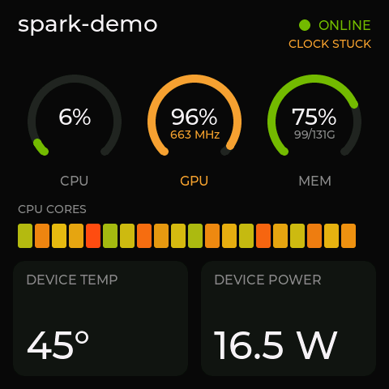

# Troubleshooting

Start with the state in the top-right corner of the screen, then the three commands that
explain almost everything:

```bash
systemctl status sparkesp32                       # on the Spark: is the agent running?
curl -s localhost:8787/healthz | python3 -m json.tool   # what it samples; is the display connected?
journalctl -u sparkesp32 -n 50 --no-pager         # agent log
```

To see the display's side of things, plug it into any machine with this repo and
`pip install pyserial`, stop the agent first if that machine is the Spark
(`sudo systemctl stop sparkesp32`), and run:

```bash
python3 tools/devctl.py status     # firmware version, settings, last sample
python3 tools/devctl.py wifi       # Wi-Fi link, poll counters, last_err
```

Start the agent again afterwards (`sudo systemctl start sparkesp32`): only one program
can talk to the display's serial port at a time.

## The screen is black

- Try another cable. Many USB-C cables are charge-only, and the board needs data to be
  flashed and fed (it powers up on either).
- `lsusb | grep 303a:1001` on the Spark (the Elecrow e-papers show up as a CH340:
  `lsusb | grep 1a86:7523`). If it's missing, the board isn't enumerating: check the
  cable and the port, then `dmesg | tail`.
- A brand-new board runs Waveshare's demo firmware until you install. Run `sudo ./install.sh`.

## WAITING, with the board plugged into the Spark

Nothing has arrived over USB yet.

- `systemctl status sparkesp32`. If it isn't running, `journalctl -u sparkesp32` says why.
- `/healthz` → `"display"` → `"state"`:
  - `searching`: the agent can't see the board on USB. An `"error"` says why opening a
    port failed. Make sure no other program has the port open (`screen`, `minicom`,
    `devctl.py`, an IDE monitor) with `sudo fuser -v /dev/ttyACM*`. Then re-run
    `sudo ./install.sh`, which also reflashes if the board isn't running SparkESP32.
    With `"ignoring"`: those devices are plugged in, but none is the display the installer
    saw, and the agent opens only that one. It's another board, a replacement, or a CH340
    board in another USB socket than before: `sudo ./install.sh` with it plugged in.
  - `handshaking`: it's asking the board who it is (up to 10 s after it's plugged in).
  - `rejected`: the board on `"port"` didn't answer as SparkESP32 within 10 s. The display
    the installer saw is asked again in `"retry_in_s"` seconds; any other device
    (`"retry_in_s": null`) not until it's replugged. Unplug it and plug it back in (a
    replugged board is retried at once). If it's rejected again, it's running different
    firmware: re-run `sudo ./install.sh` to flash it.
  - `streaming`: all good; `"answered_in_s"` is how long the board took to answer.
- ModemManager probing the port garbles the console. The installer's udev rule stops that.
  It goes by USB ID, so ModemManager also leaves alone every other CH340, CH343, CH9102 and
  CP210x adapter on the Spark. If a modem of yours sits behind one of those chips, delete
  `/etc/udev/rules.d/99-sparkesp32.rules`'s line for it and run `sudo udevadm control --reload`.
  Check it's present: `cat /etc/udev/rules.d/99-sparkesp32.rules`.

## OFFLINE

The link is up but samples stopped. The screen's second line says why (over Wi-Fi):

| Second line | Meaning | Fix |
|---|---|---|
| agent stopped | the Spark refused the connection: nothing listens on :8787 | `systemctl status sparkesp32`; `sudo systemctl restart sparkesp32` |
| Spark unreachable | no answer, or `<host>.local` doesn't resolve | is the Spark on? Same LAN? Try `--host <ip>`; is the display's Wi-Fi on another subnet than the Spark? Then `sudo ./install.sh --lan <its subnet>` |
| agent stale | HTTP 503: the agent is up but its sampler stalled | `journalctl -u sparkesp32` |
| bad reply | another service answers, or an old agent | check the URL (`devctl.py wifi`); update the agent |

- Over USB there is no second line: the agent stopped (`systemctl status sparkesp32`) or the Spark is off.
- For the raw details, run `devctl.py wifi` on a machine the board is plugged into. Its
  `link` line shows the link state and the last poll (`feed=`), and `last_err` the exact error:

| `last_err` | Meaning | Fix |
|---|---|---|
| `connect ESP_ERR_HTTP_CONNECT` | can't reach the agent | Is `<host>.local` resolvable on your LAN? Try `--host <ip>`. Is the board on another subnet than the Spark? The agent and the ufw rule (`sudo ufw status`) only let the Spark's own subnet in: `sudo ./install.sh --lan <the board's subnet>`. Is the board on an isolated guest/IoT network? |
| `http 503` | agent is up but its sampler stalled | `journalctl -u sparkesp32`; `sudo systemctl restart sparkesp32` |
| `http 404` | something else answers on that port | check the URL: `devctl.py wifi` shows it; fix with `--host` |
| `bad stat line (too many fields: update the agent)` | the agent speaks an older protocol | `git pull && sudo ./install.sh` on the Spark |
| `bad stat line (<field>)` | a value out of range | open an issue with the `/stat` output |

From another machine on the same LAN, `curl http://<spark>.local:8787/stat` should
print one `stat ...` line.

## NO WI-FI

Wi-Fi is configured but the board can't join. The second line is `joining...` while it
tries, then `no network` (reason 201/212), `wrong password` (15/202/204) or `can't join`
(anything else). `devctl.py wifi` shows the `link` state and `last_err` as
`join '<ssid>' reason <n>`:

| reason | Meaning | Usually |
|---|---|---|
| 201 | no AP found | wrong name, or the network is 5/6 GHz only (the ESP32-C6 and S3 are **2.4 GHz only**) |
| 15, 204 | 4-way handshake timeout | wrong password |
| 202 | authentication failed | wrong password, or WPA3-only network with incompatible settings |
| 210, 211 | no AP with compatible security | the network needs something other than WPA2/WPA3-Personal (e.g. 802.1X), or it's WEP/open-only with odd settings |
| 2, 200 | auth expired / beacon timeout | weak signal; move the board closer |

`python3 tools/devctl.py wifi scan` lists what the board can see, with signal strength
and security. To fix the settings, re-run `sudo ./install.sh --ssids "<name>"` (the
password is prompted). The board rotates through up to 4 SSIDs, moving to the next
after 3 failed joins.

## SET HOST

The board is on Wi-Fi but has no agent address. Run `sudo ./install.sh --host <spark-name>.local`,
or `--host <ip>`.

## CLOCK STUCK



The GPU ring turned amber and the line under ONLINE reads **CLOCK STUCK** (on the
black-and-white RLCD, that line and the GPU ring's title are inverted): the GPU has run
under load (80 %+ utilization) at under 1000 MHz,
with no throttle reason, for 10 seconds. That's the GB10's stuck-clock state, reported on
DGX Spark and its OEM versions: the GPU runs at 500–850 MHz and ~15–20 W instead of
~2,000–2,400 MHz and ~90 W, so everything on it takes two to three times as long, and
nothing in the logs says why.

- **A reboot doesn't clear it**, and `nvidia-smi -lgc` is accepted and ignored.
- **A full power drain does:** shut the Spark down, unplug its power adapter from the wall
  and from the Spark (and its USB devices), wait at least 5 minutes, then plug the adapter
  into the wall first and the Spark last, and power on. Some owners needed a longer wait.
- If it comes back, NVIDIA's moderators are collecting cases in
  [this forum thread](https://forums.developer.nvidia.com/t/386060), with what to capture
  (`sudo nvidia-bug-report.sh`, `nvidia-smi -q -d CLOCK,POWER,TEMPERATURE,PERFORMANCE`)
  before the power drain.

What the agent saw is in `/healthz` (`gpu`, `gpu_mhz`, `gpu_clock_events`: the active
clock event reasons, `0` for none, and `gpu_clock_stuck`) and in its log
(`journalctl -u sparkesp32 | grep "GPU clock"`). The warning clears by itself after
5 seconds under load at 1400 MHz or more. A slowdown that reports a reason (too hot, a power
brake, a power cap, an application clock limit) never counts as stuck. How the agent
decides is in [protocol.md](protocol.md#the-stuck-clock-verdict).

The number under the GPU % is the clock either way. If there's no number, the agent or
the firmware predates it: update both with `sudo ./install.sh`.

## GPU, temperature or power show `--`

The agent couldn't read them. If `/healthz` → `"source"` is `"sparkline"`, they come from
Sparkline (see below). Otherwise they come from `nvidia-smi`: check `"gpu_source"` (and
`"gpu_error"` for the details):

- `unavailable`: the NVIDIA driver/tools aren't installed or aren't on `PATH` for the
  service.
- `exited`: it crashed or the driver isn't loaded; `nvidia-smi` by hand will say why.
  The agent restarts it with backoff.
- `stalled`: it stopped printing without exiting (a hung driver call). The agent kills
  and restarts it; if this keeps happening, the driver itself is stuck.
- `idle`: `nvidia-smi` isn't running because the readings come from Sparkline.

CPU, memory and the core heatmap don't depend on `nvidia-smi`.

## Readings from Sparkline

On a Spark that runs [Sparkline](https://github.com/sfxnz/sparkline), the installer sets
the agent to read Sparkline's samples. `/healthz` shows which source is live:

- `"source": "sparkline"`: the numbers come from Sparkline's agent.
- `"source": "own"` with `"sparkline": {"state": "error", "error": ...}`: Sparkline
  didn't answer, so the agent samples by itself and asks Sparkline again every 30 s.
  `token rejected` means Sparkline's agent token changed: re-run `sudo ./install.sh`.
  A refused connection or a timeout means Sparkline's agent is down or moved.
  `isn't this host` means the address saved for Sparkline now belongs to another
  machine, so the agent didn't send it the token: re-run `sudo ./install.sh`.

To sample on the Spark without Sparkline, run `sudo ./install.sh --no-sparkline`.

## A model won't load, but the panel shows free memory

The MEM ring counts used memory as `MemTotal − MemAvailable` from `/proc/meminfo`, the same
estimate of allocatable memory that NVIDIA recommends for DGX Spark. `MemAvailable` includes
page cache the kernel can reclaim (for example, model files you read recently), so on a
busy Spark much of what the panel shows as free can be cache.

Some applications size themselves with CUDA's `cudaMemGetInfo` instead. On the Spark's
unified memory it can report less than the system could actually allocate, because it
doesn't count memory the CPU could reclaim, and an application that trusts it can refuse a
load the Spark has room for. NVIDIA's
[known issues](https://docs.nvidia.com/dgx/dgx-spark/known-issues.html#guidance-for-reporting-memory-resources-with-unified-memory-architecture)
give a workaround for debugging: flush the page cache, then restart the application.

```bash
grep -E '^(MemFree|MemAvailable|Cached):' /proc/meminfo   # how much of "available" is cache
sudo sh -c 'sync; echo 3 > /proc/sys/vm/drop_caches'      # flush it, then restart the app
```

The panel keeps no history, so it can't tell you after the fact what memory looked like
when a load failed.

## The image is sideways

`sudo ./install.sh --rotation none|ccw|cw`. The default `cw` is the board's upright
position: on the C6 AMOLED and the ES3C28P, USB-C on the right; on the RLCD, sitting
on its stand. A
board with a rectangular screen is laid out for one shape and
takes only the two rotations that keep it: the S3 boards are landscape, `ccw` or `cw`,
and answer `ERR rot none not supported on this board` to the third. The 5.79" e-paper
takes `cw` (wide) and `ccw` (tall) and refuses `none`; the 4.2" e-paper is landscape,
`cw` or `ccw`.

## The e-paper

The Elecrow e-papers (5.79" and 4.2") behave differently from the lit screens, by design:

- **New readings show every 10 s**, not every second. Each update is a partial refresh:
  only the pixels that change are redrawn, with no flash. A change of state (ONLINE to
  OFFLINE, CLOCK STUCK) shows at once.
- **About once an hour the whole screen flashes black and white** for a second or two. That's
  the full refresh that wipes the faint ghosts partial refreshes leave. It also happens
  at start-up and after a rotation.
- **It shows ONLINE with old numbers when the board has no power.** E-paper keeps its
  image unpowered. The red LED is lit while the firmware runs: no LED, no live data.
- **Tall or wide** (5.79"): `sudo ./install.sh --rotation ccw` stands it on its short end
  with the USB-C port on the right; `--rotation cw` is wide.
- **A 4.2" that stays blank or never finishes a refresh** is probably the V1.0 board (no
  green sticker on the back, an SSD1683 controller), which this firmware doesn't drive.
  Restore its factory flash (`esptool write_flash 0x0 <backup>`).
- `/healthz` → `"display"` → `"state": "rejected"` with `"retry_in_s": null`: the agent
  asked a device the installer hasn't seen whether it's a SparkESP32 and got no answer (a
  bridge is asked at 115200 and at 1.3.0's 921600), or another program has a bridge's port
  locked, so it leaves that device alone until it's replugged. Unplug and replug the board,
  or check it runs SparkESP32 (`devctl.py status`), then `sudo ./install.sh`.

## Flashing fails

- Hold the board's **BOOT** button while plugging it in (forces the ROM bootloader), then
  re-run `sudo ./install.sh --reflash`.
- `several USB serial devices that could be the display`: two displays (or a display and
  another Espressif board) are attached. Pick one with `--port`
  (`/dev/ttyACMn`, or `/dev/ttyUSBn` for a board behind a USB-UART bridge).
- `... is a USB-UART bridge that doesn't answer as a SparkESP32: leaving it alone`: a
  CH340/CP210x device is plugged in but isn't running SparkESP32. If it's a new display
  (an Elecrow e-paper), name it so the installer flashes it:
  `sudo ./install.sh --board elecrow-esp32s3-epaper-5.79` (or `elecrow-esp32s3-epaper-4.2`).
- `couldn't identify the board` or `pick its board with --board`: the board isn't running
  SparkESP32 yet and its chip matches more than one supported board, or none. Name it:
  `sudo ./install.sh --board <id>` (`./install.sh --help` lists the ids).
- esptool says the image `is not an ESP32-...` image: the firmware is for a different
  board than the one plugged in. Check `--board`. The installer resets the board
  afterwards, so it isn't left stuck in its bootloader.

## Starting over

```bash
sudo ./install.sh --uninstall         # service, udev rule, ufw rule, /opt/sparkesp32
python3 tools/devctl.py wifi clear    # optional: make the board forget its Wi-Fi
```

The board keeps its name and Wi-Fi settings across reinstalls and firmware updates.
Only a merged-image flash or `wifi clear` erases them.
