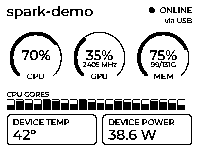

# Elecrow CrowPanel ESP32 4.2" E-Paper (V1.2)

[Product page](https://www.elecrow.com/crowpanel-esp32-4-2-e-paper-hmi-display-with-400-300-resolution-black-white-color-driven-by-spi-interface.html) ·
[wiki for V1.2](https://www.elecrow.com/wiki/New_E-Paper_4.2-inch_Arduino_Tutorial.html) ·
[Elecrow's code and schematic](https://github.com/Elecrow-RD/CrowPanel-ESP32-4.2-E-paper-HMI-Display-with-400-300).
The smaller e-paper: the 5.79"'s refresh policy on a 400×300 panel with a single
controller of another family. **V1.2 boards only** (see below). The C6 AMOLED stays the
recommended board.

The demo screen at load 70, as the 1-bit panel shows it: LVGL's render through
`display.c`'s threshold. The layout is the RLCD's: both are 400×300 black and white.

| | |
|---|---|
| Chip | ESP32-S3 (S3R8): 8 MB flash, 8 MB octal PSRAM |
| Display | 4.2" 400×300 e-paper, black and white, one UltraChip-style controller (UC8276C class), SPI (10 MHz) |
| USB | a CH340C USB-UART bridge (1a86:7523) to UART0: the console and the agent's USB feed, at 115200 baud |
| Unused | the rotary switch and HOME/EXIT keys, the microSD slot, the battery connector, the GPIO header |

## Which board you have

Elecrow made two versions with the same pins and different panel controllers:

| Version | How to tell | Controller | Here |
|---|---|---|---|
| V1.2 (PCBA V1.2A) | a **green circular sticker** on the back | UltraChip style (UC8276C class) | supported |
| V1.0 | no sticker | SSD1683 | not supported: the commands differ, and one controller's software reset is the other's refresh |

Not sure? Back up the factory flash and compare its app (`0x10000`, the first 1,612,272
bytes) with Elecrow's
[V1.2A factory image](https://github.com/Elecrow-RD/CrowPanel-ESP32-4.2-E-paper-HMI-Display-with-400-300/tree/master/factory_firmware):
identical means V1.2. That's how this port's board was identified.

## Pins

The same as the 5.79" CrowPanel's.

| Signal | GPIO |
|---|---|
| E-paper SCK / MOSI | 12 / 11 |
| E-paper CS / DC / RST | 45 / 46 / 47 |
| E-paper BUSY (**low** while it works) | 48 |
| E-paper power switch (high = on) | 7 |
| Power LED (lit while the board runs) | 41 |
| Keys HOME / EXIT / PRV / NEXT / OK (unused) | 2 / 1 / 6 / 4 / 5 |

## How the display works here

- **The controller sleeps between refreshes.** Each refresh starts from a hardware reset
  and the panel setup, sends the image shown now (`0x10`) and the one to show (`0x13`),
  loads a waveform into the LUT registers (`0x20`–`0x24`), refreshes (`0x17`), and puts the
  controller back into deep sleep (`0x07`).
- **Refreshing without flashing.** Updates use the DU ("direct update") waveform: one short
  phase that moves only the pixels that change, about 0.8 s including the wake-up, no
  flash. Blacks come out a little softer than after a full refresh. The GC ("global
  clear") waveform drives every pixel through black and white: about 1.5 s of flashing, at
  start-up, after a rotation and once an hour, to wipe the ghosts DU leaves behind. The
  e-paper task and the 10 s cadence (`BOARD_UI_MIN_REFRESH_MS`) are the 5.79"'s; see its
  README.
- **BUSY is active low.** Measured on the board: BUSY falls when the refresh starts and
  rises about 1.2 s later, when a GC waveform ends. Elecrow's examples read it the other way
  round (their ESPHome driver leans on a 15 s timeout).
- **Landscape only.** `rot cw` (the default) is upright with the USB-C port on the left;
  `rot ccw` is the same turned 180 degrees. `rot none` answers
  `ERR rot none not supported on this board`.
- **The USB-UART bridge.** The USB-C port goes to a CH340C, so the console runs on UART0
  at its default 115200 (a screenshot takes about 30 s). The agent and tools find CH340
  bridges as well as the native USB ID; see the 5.79"'s README.
- **E-paper keeps its image unpowered.** The red power LED is lit while the firmware runs:
  no LED, no live data.

The pins, the panel setup and the waveform values come from Elecrow's V1.2 Arduino examples
and ESPHome component for this board (no license stated: facts only). The code is our own
(see THIRD_PARTY_NOTICES.md).

## Verified

On the real board (V1.2, identified by its factory image), 2026-11-22, firmware 1.3.0 + this
port, ESP-IDF 5.5.6, driven from a DGX Spark over its CH340:

- the whole flash was backed up first; the factory app is byte-identical to Elecrow's
  V1.2A image
- flashes, boots, answers the handshake (`board=elecrow-esp32s3-epaper-4.2`)
- the physical screen, photographed: upright, black on white, nothing mirrored or cut off
- partial refreshes change in place with no flash (watched on the glass): about 0.8 s each;
  a frame identical to the glass is skipped; ONLINE to OFFLINE shows at once. Full
  refreshes at start-up: about 1.5 s
- BUSY's polarity, from a trace of its edges after the refresh command
- demo screenshots at loads 0, 70 and 100, and a worst case (every value at its widest, a
  22-character hostname, CLOCK STUCK): measured, the ring text clears the arcs by 4.9 px,
  "140.0 W" its tile by 56 px, the title the status by 51 px
- screenshots over the Spark's CH340 at 115200: 5 of 5 clean (at 921600, 2 of 10 had
  damaged lines)
- `rot cw` and `rot ccw` redraw and persist; `rot none` is refused
- a reflash keeps the name
- five chip resets in a row: the handshake answered after 4.6 s each time

On the Spark, with this branch's installer and agent: the installer found the board on
`/dev/ttyUSB0`, left its firmware alone and set up Wi-Fi; the agent streams to it (protocol
v2) and got its handshake at once, so opening the port doesn't reset it.

On Wi-Fi alone (unplugged from the Spark, on a USB charger): it joins, polls the Spark's
agent and reads ONLINE · via WI-FI with live values (photographed).
