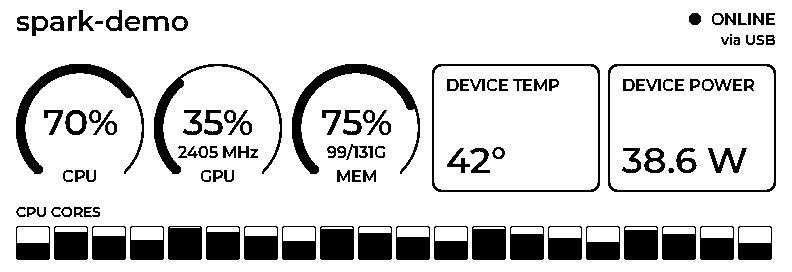
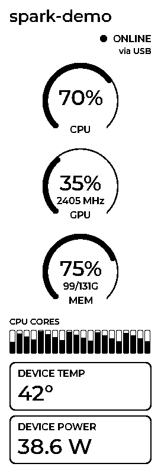

# Elecrow CrowPanel ESP32 5.79" E-Paper

[Product page](https://www.elecrow.com/crowpanel-esp32-5-79-e-paper-hmi-display-with-272-792-resolution-black-white-color-driven-by-spi-interface.html) ·
[wiki](https://www.elecrow.com/wiki/CrowPanel_ESP32_E-Paper_5.79inch_Arduino_Tutorial.html) ·
[Elecrow's code and schematic](https://github.com/Elecrow-RD/CrowPanel-ESP32-5.79-E-paper-HMI-Display-with-272-792).
The e-paper example: a wide 792×272 panel run by two cascaded controllers, a refresh
policy that never flashes for an update, a tall mode for standing it on its end, and a
USB-UART bridge instead of the chip's own USB. The C6 AMOLED stays the recommended board.

The demo screen at load 70, wide, as the 1-bit panel shows it: LVGL's render through
`display.c`'s threshold. Tall (`rot ccw`):

| | |
|---|---|
| Chip | ESP32-S3 (S3R8): 8 MB flash, 8 MB octal PSRAM |
| Display | 5.79" 792×272 e-paper (DIS08792E), black and white, two SSD1683 controllers in cascade, SPI (10 MHz) |
| USB | a CH340 USB-UART bridge (1a86:7523) to UART0: the console and the agent's USB feed, at 921600 baud |
| Unused | the rotary switch and HOME/EXIT keys, the microSD slot, the battery connector, the 2×10 header |

## Pins

| Signal | GPIO |
|---|---|
| E-paper SCK / MOSI | 12 / 11 |
| E-paper CS / DC / RST | 45 / 46 / 47 |
| E-paper BUSY (high while it works) | 48 |
| E-paper power switch (high = on) | 7 |
| Power LED (lit while the board runs) | 41 |
| Keys HOME / EXIT / PRV / NEXT / OK (unused) | 2 / 1 / 6 / 4 / 5 |

## How the display works here

- **Two controllers, one panel.** One SSD1683 drives 400 columns, so the panel has two in
  cascade: the slave runs the left half, the master the right half, mirrored. A command
  with bit 7 set goes to the slave (`0x24` → `0xA4`). Each drives 396 columns of its
  400-pixel RAM row, with the 4 dead ones at the seam, so a 99-byte frame row splits with
  one byte in common: bytes 0–49 to the slave, 49–98 to the master.
- **Refreshing without flashing.** LVGL renders an RGB565 canvas in PSRAM; `display.c`
  thresholds it into a 1-bit frame (85% luminance, as on the RLCD: strokes come out bold).
  A task puts frames on the glass:
  - a frame identical to what's on the glass is skipped;
  - otherwise a **partial refresh** (the controller's black-and-white waveform, which
    only drives pixels that differ from the old image): about 0.5 s, no flash;
  - a **full refresh** (the fast "3-color" waveform, which drives every pixel): about
    1.8 s of black-and-white flashing, at start-up, after a rotation and **once an hour**,
    to wipe the faint ghosts partial refreshes leave.
- **Cadence.** `BOARD_UI_MIN_REFRESH_MS` (10 s) in `board_config.h`: new readings reach the
  screen at most every 10 s, so the panel isn't redrawn every second. A change of state
  (ONLINE to OFFLINE, CLOCK STUCK) still shows at once. At 10 s that's about 3 million
  partial refreshes a year; only the pixels that change are driven.
- **Wide or tall.** `rot cw` (the default) is wide: 792×272, upright with the USB-C port
  on the bottom edge. `rot ccw` is tall: 272×792 with a layout of its own, for standing
  the board on its short end (on a Spark, say) with the USB-C port on the right. `rot
  none` answers `ERR rot none not supported on this board`. A rotation changes the
  canvas's shape, so the shared UI lays itself out again.
- **The USB-UART bridge.** The USB-C port is wired to a CH340, not to the ESP32-S3's own
  USB, so the console runs on UART0 at 921600 (a screenshot takes about 7 s). The agent
  and the host tools look for CH340 and CP210x bridges as well as the native USB ID, and
  open every port at 921600 (native USB ignores the rate). Opening the port doesn't reset
  the board.
- **E-paper keeps its image unpowered.** If the board loses power, the last screen stays,
  ONLINE and all. The red power LED is lit whenever the firmware runs: no LED, no live data.
- `devctl.py shot` shows LVGL's render, before the 1-bit conversion; every `shot` also
  updates the glass.

The pins and the controllers' command values come from Elecrow's factory source for this
board, the [ESPHome driver by Sam Perkins](https://github.com/samperk1/esphome-crowpanel-579)
(MIT), [GxEPD2](https://github.com/ZinggJM/GxEPD2)'s GDEY0579T93 driver (GPL-3.0) and the
SSD1683 datasheet. The code is our own (see THIRD_PARTY_NOTICES.md).

## Verified

On the real board, 2026-11-22 (firmware 1.2.0 + this port, ESP-IDF 5.5.6), driven from a Mac:

- identified first: the factory image is Elecrow's Arduino build for this board
  (`CrowPanel5-79`), an ESP32-S3 with 8 MB flash and 8 MB octal PSRAM behind a CH340;
  the whole flash was backed up before anything was written
- flashes over the CH340, boots, answers the handshake (`board=elecrow-esp32s3-epaper-5.79`);
  opening the port doesn't reset the board (checked against a deliberate reset)
- the physical screen, photographed, wide and tall: upright, black on white, nothing
  mirrored, the seam between the two controllers invisible (the MEM ring crosses it)
- partial refreshes change in place with no flash (watched on the glass): about 0.53 s
  each; a frame identical to the glass is skipped; ONLINE to OFFLINE shows at once
- full refreshes at start-up (about 1.8 s), after a rotation, and on the hour (checked with
  the interval cut to 45 s)
- demo screenshots at loads 0, 70 and 100, wide and tall, and a worst case (every value
  at its widest, a 22-character hostname, CLOCK STUCK): measured, the ring text clears
  the arcs by 5 px, "140.0 W" its tile by 9 px, every element its neighbors by 7 px or more
- `rot cw` (wide) and `rot ccw` (tall) redraw and persist; `rot none` is refused
- on Wi-Fi it joins, polls a Spark's agent, and reads `screen=online reason='via WI-FI'`
  with live values
- a reflash keeps the name and Wi-Fi settings
- five chip resets in a row (EN through the CH340, which also cuts the panel's power
  switch): the handshake answered after 4.7 s each time

On a DGX Spark (DGX OS), the same day, with this branch's installer and agent:

- plugged in cold (the CH340 enumerating from scratch), the board came up and the
  installer found it on `/dev/ttyUSB0`, left its firmware alone and set `--rotation ccw`
- the agent streams to it (`/healthz`: `streaming`, protocol v2) and got its handshake
  answer at once (0.0 s), so opening the port on Linux doesn't reset the board either
- ModemManager, active on DGX OS, ignores the bridge (`ID_MM_DEVICE_IGNORE=1` from the
  udev rule)

Not yet: repeated cold plug-ins on the Spark (one so far).
