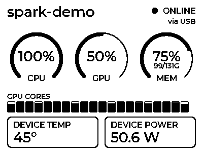

# Waveshare ESP32-S3-RLCD-4.2

[Product page](https://www.waveshare.com/esp32-s3-rlcd-4.2.htm) ·
[docs](https://docs.waveshare.com/ESP32-S3-RLCD-4.2). The example of a panel with no
`esp_lcd` driver: a hand-written ST7306 driver and a mono theme. The C6 AMOLED stays
the recommended board.

The demo screen at load 100, as the 1-bit panel shows it: LVGL's render through `display.c`'s threshold.

| | |
|---|---|
| Chip | ESP32-S3 (S3R8): 16 MB flash, 8 MB octal PSRAM |
| Display | 4.2" 300×400 reflective LCD, black and white, ST7306 over SPI (10 MHz), no backlight |
| USB | native USB-Serial/JTAG (303a:1001): the console and the agent's USB feed |
| Unused | PCF85063 RTC, SHTC3 sensor, audio, microSD, the 18650 holder (the PWR key and charger work in hardware) |

## Pins

| Signal | GPIO |
|---|---|
| LCD SCLK / MOSI | 11 / 12 |
| LCD DC / CS / RST | 5 / 40 / 41 |
| KEY / BOOT buttons (unused) | 18 / 0 |

## How the display works here

- No esp_lcd panel driver fits the ST7306, so `board.c` sends its power-up
  sequence directly over an esp_lcd SPI IO handle. The register values come from
  Waveshare's ESP-IDF examples for this board and the Zephyr project's devicetree
  (both Apache-2.0); the code is our own (see THIRD_PARTY_NOTICES.md).
- The values are the examples' and Zephyr's (`C1 0x69`, `C4 0x4B`, `D8 80 E9`,
  `B2 02`); they give good contrast on the real board. Waveshare's factory test
  firmware uses `0x41`, `0x41`, `A6 E9` and `05` for the same four registers.
- Thresholding: only nearly white pixels (85% luminance) stay white, so the
  anti-aliased edges of text go black and strokes come out bolder. At 50%, small
  text looked thin on the real panel.
- The controller packs a 4-column × 2-row block into each byte. LVGL renders a
  400×300 RGB565 canvas in PSRAM; `display.c` thresholds each pixel to black or
  white and writes it straight into the panel's 15 KB frame, rotated, then sends
  the whole frame (about 12 ms).
- Landscape only: `rot cw` (the default) is upright with the board on its stand;
  `rot ccw` is the same turned 180 degrees. `rot none` (portrait) answers
  `ERR rot none not supported on this board`.
- `devctl.py shot` shows LVGL's render before the 1-bit conversion.

## Verified

On the real board, 2026-11-21 (firmware 0.1.0, ESP-IDF 5.5.6), driven from a Mac:

- flashes over USB, boots, answers the handshake (`board=waveshare-esp32s3-rlcd-4.2`)
- the physical screen, photographed: upright on its stand, black on white, good contrast
- demo screenshots at load 100: nothing clipped or touching
- `rot cw` and `rot ccw` work and persist; `rot none` is refused
- on Wi-Fi it joins, polls a Spark's agent, and reads `screen=online reason='via WI-FI'`
  with live values
- a reflash keeps the name and Wi-Fi settings

Not yet: a cold plug-in, and the installer on a Spark.

The first board tested as "the RLCD" was an ES3C28P from a swapped box (now
[its own port](../lcdwiki-esp32s3-tft-2.8/)). Its handshake, screenshots and Wi-Fi all
passed with no RLCD attached, which is why the guide now starts by proving which board
you have.
